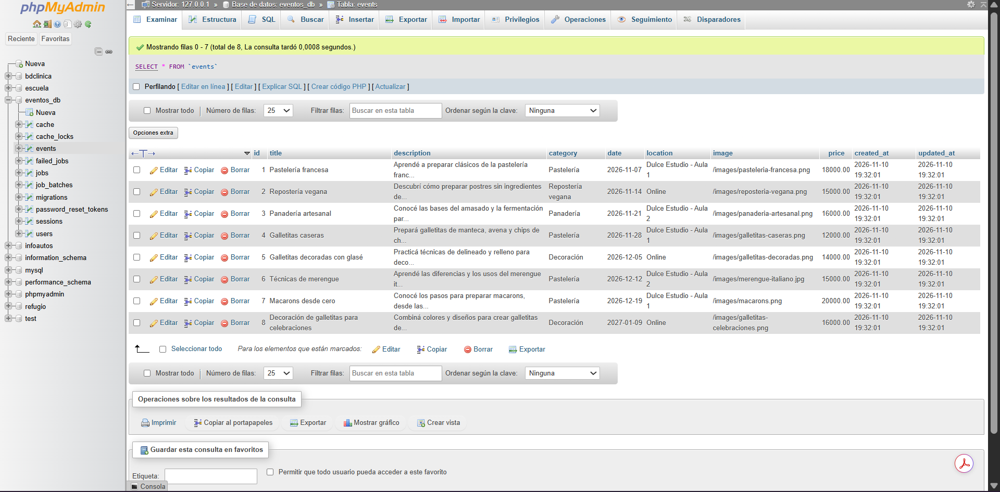

# Dulce Estudio

## Descripción

Dulce Estudio es una plataforma de talleres y cursos de pastelería,
dirigida tanto a personas que recién comienzan como a quienes ya
tienen experiencia y quieren seguir aprendiendo.

Este proyecto corresponde al Trabajo Práctico 4 de Programación Web Avanzada. Continúa el TP3 y reutiliza sus componentes de React. Los datos de los talleres se guardan en MySQL.

## Integrantes

- Karen Galan — Legajo FAI-5706.
- Virginia Lindor — Legajo FAI-5711.

## Tecnologías utilizadas

- React.
- JavaScript.
- Tailwind CSS.
- Vite.
- HTML.
- PHP.
- Laravel 12.
- Inertia.js 2.
- MySQL.
- Eloquent.
- Composer.

## Funcionalidades

- Visualización de ocho talleres de prueba, ordenados por fecha.
- Filtrado de talleres por categoría.
- Búsqueda por nombre, sin distinguir mayúsculas y minúsculas.
- Combinación del filtro por categoría con la búsqueda.
- Mensaje cuando no se encuentran resultados.
- Diseño adaptable a celulares, tablets y computadoras.

## Instrucciones de ejecución

Se necesita PHP 8.2 o superior con PDO MySQL habilitado, Composer, Node.js, npm y MySQL o MariaDB. El proyecto se probó con Node.js 24 y el servicio MySQL de XAMPP.

1. Clonar el repositorio y entrar en la carpeta.

   ```bash
   git clone https://github.com/karengalan/DulceEstudio.git
   cd DulceEstudio
   ```

2. Instalar las dependencias.

   ```bash
   composer install
   npm install
   ```

3. En la primera instalación, crear el archivo `.env` y generar la clave de Laravel. En Windows, ejecutar estos comandos desde Git Bash.

   ```bash
   cp .env.example .env
   php artisan key:generate
   ```

4. Iniciar MySQL y crear una base vacía llamada `eventos_db` en phpMyAdmin. Revisar en `.env` que los datos coincidan con la instalación local. `.env.example` trae esta configuración de ejemplo.

   ```dotenv
   DB_CONNECTION=mysql
   DB_HOST=127.0.0.1
   DB_PORT=3306
   DB_DATABASE=eventos_db
   DB_USERNAME=root
   DB_PASSWORD=
   ```

5. Crear las tablas y cargar los talleres. Ejecutar el seeder una vez sobre la base recién creada.

   ```bash
   php artisan migrate
   php artisan db:seed --class=EventSeeder
   ```

6. Iniciar Laravel en una terminal.

   ```bash
   php artisan serve
   ```

7. En otra terminal, dentro de la misma carpeta, iniciar Vite.

   ```bash
   npm run dev
   ```

Con ambos servidores activos, abrir [Dulce Estudio](http://127.0.0.1:8000/eventos). La página de inicio también redirige al listado de talleres.


## Capturas

### Tabla `events` en phpMyAdmin



### Página `/eventos`

