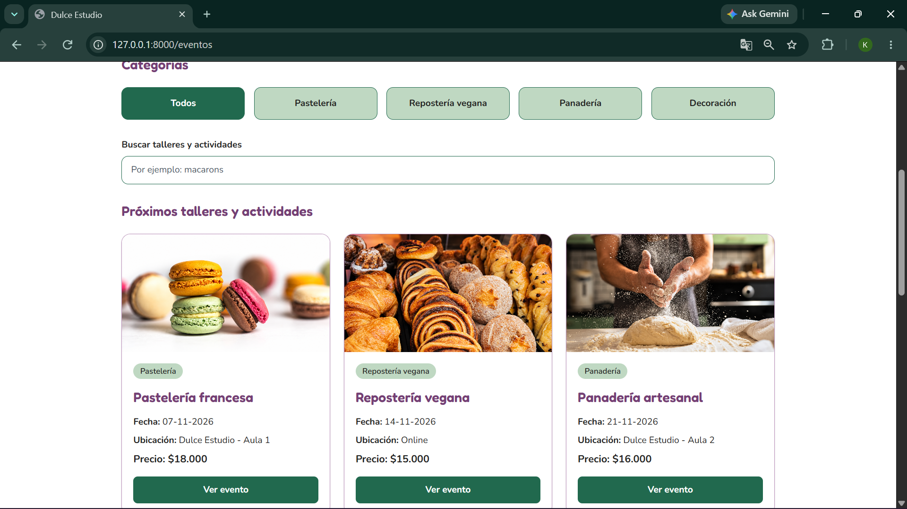

# Dulce Estudio

## Descripción

Dulce Estudio es una plataforma de talleres y cursos de pastelería,
dirigida tanto a personas que recién comienzan como a quienes ya
tienen experiencia y quieren seguir aprendiendo.

Este proyecto corresponde al Trabajo Práctico 4 de Programación Web Avanzada. Continúa el TP3 y reutiliza sus componentes de React. Los datos de los talleres se guardan en MySQL.

## Integrantes

- Karen Galan — Legajo FAI-5706.
- Virginia Lindor — Legajo FAI-5711.

## Tecnologías utilizadas

- React.
- JavaScript.
- Tailwind CSS.
- Vite.
- HTML.
- PHP.
- Laravel 12.
- Inertia.js 2.
- MySQL.
- Eloquent.
- Composer.

## Funcionalidades

- Visualización de ocho talleres de prueba, ordenados por fecha.
- Filtrado de talleres por categoría.
- Búsqueda por nombre, sin distinguir mayúsculas y minúsculas.
- Combinación del filtro por categoría con la búsqueda.
- Mensaje cuando no se encuentran resultados.
- Vista de detalle de cada taller en `/eventos/{id}`.
- Categorías del filtro generadas a partir de los talleres cargados.
- Imágenes optimizadas en formato WebP para una carga más rápida.
- Diseño adaptable a celulares, tablets y computadoras.

## Estructura de componentes y estado

### Rutas

| Ruta | Qué hace | Página de React |
|---|---|---|
| `/` | Redirige a `/eventos`. | - |
| `/eventos` | Lista los talleres ordenados por fecha. | `Events/Index` |
| `/eventos/{id}` | Muestra el detalle de un taller. Si el id no existe, responde 404. | `Events/Show` |

### Flujo de datos

`EventController` consulta los talleres con Eloquent y los envía a la página mediante Inertia. Cada página de React los recibe por props: `events` en `Index` y `event` en `Show`.

### Componentes

- `Pages/Events/Index.jsx`: página del listado. Guarda el estado y calcula la lista de talleres a mostrar.
- `Pages/Events/Show.jsx`: página con el detalle de un taller.
- `Components/Header.jsx`, `Hero.jsx` y `Footer.jsx`: encabezado, presentación y pie de página.
- `Components/ListaCategorias.jsx` y `TarjetaCategorias.jsx`: botones del filtro por categoría.
- `Components/Buscador.jsx`: campo de búsqueda por nombre.
- `Components/ListaEventos.jsx` y `TarjetaEventos.jsx`: lista de talleres y tarjeta de cada uno, con enlace al detalle.
- `utils/format.js`: funciones `formatearFecha` y `formatearPrecio`, usadas en la tarjeta y en el detalle.

### Estado

El estado vive en `Index.jsx` con `useState`:

- `categoriaSeleccionada`: categoría activa, que empieza en `Todos`.
- `busqueda`: texto escrito en el buscador.

Con esos dos valores, `Index` filtra los talleres y le pasa a `ListaEventos` solo los que coinciden. Las categorías se obtienen de los propios talleres, por lo que si se agrega una nueva en la base, aparece sola en el filtro. `ListaCategorias` y `Buscador` reciben el valor actual y una función para modificarlo, y no guardan estado propio.

## Modelo de datos

El proyecto usa tres tablas relacionadas entre sí.

| Tabla | Qué guarda | Campos principales |
|---|---|---|
| `users` | Las personas que usan la plataforma. | `id`, `name`, `email`, `password` |
| `categories` | Las categorías de los talleres. | `id`, `name` (único) |
| `events` | Los talleres. | `id`, `user_id`, `category_id`, `title`, `description`, `date`, `location`, `image`, `price` |

### Relaciones

- Un usuario tiene muchos talleres, y cada taller pertenece a un usuario (`hasMany` en `User` y `belongsTo` en `Event`).
- Una categoría tiene muchos talleres, y cada taller pertenece a una categoría (`hasMany` en `Category` y `belongsTo` en `Event`).

### Claves foráneas de `events`

- `user_id` apunta a `users.id`. Si se elimina el usuario, se eliminan sus talleres.
- `category_id` apunta a `categories.id`. Si se elimina la categoría, sus talleres quedan sin categoría.

Las dos columnas aceptan valores nulos, porque se agregaron con una migración sobre una tabla que ya tenía talleres. La columna de texto `category` se mantiene por ahora, porque el listado la usa para filtrar. La relación con la tabla `categories` se establece mediante `category_id`.

## Instrucciones de ejecución

Se necesita PHP 8.2 o superior con PDO MySQL habilitado, Composer, Node.js, npm y MySQL o MariaDB. El proyecto se probó con Node.js 24 y el servicio MySQL de XAMPP.

1. Clonar el repositorio y entrar en la carpeta.

   ```bash
   git clone https://github.com/karengalan/DulceEstudio.git
   cd DulceEstudio
   ```

2. Instalar las dependencias.

   ```bash
   composer install
   npm install
   ```

3. En la primera instalación, crear el archivo `.env` y generar la clave de Laravel. En Windows, ejecutar estos comandos desde Git Bash.

   ```bash
   cp .env.example .env
   php artisan key:generate
   ```

4. Iniciar MySQL y crear una base vacía llamada `eventos_db` en phpMyAdmin. Revisar en `.env` que los datos coincidan con la instalación local. `.env.example` trae esta configuración de ejemplo.

   ```dotenv
   DB_CONNECTION=mysql
   DB_HOST=127.0.0.1
   DB_PORT=3306
   DB_DATABASE=eventos_db
   DB_USERNAME=root
   DB_PASSWORD=
   ```

5. Crear las tablas y cargar los datos de ejemplo. El seeder crea los ocho talleres, las cuatro categorías y un organizador de ejemplo. Ejecutar el seeder sobre la base recién creada.

   ```bash
   php artisan migrate
   php artisan db:seed --class=EventSeeder
   ```

6. Iniciar Laravel en una terminal.

   ```bash
   php artisan serve
   ```

7. En otra terminal, dentro de la misma carpeta, iniciar Vite.

   ```bash
   npm run dev
   ```

Con ambos servidores activos, abrir [Dulce Estudio](http://127.0.0.1:8000/eventos). La página de inicio también redirige al listado de talleres.


## Capturas

### Tabla `events` en phpMyAdmin


### Página `/eventos`

